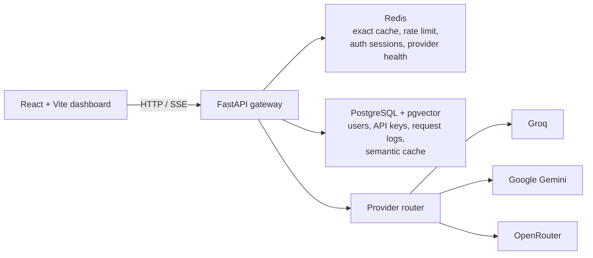

# AI Proxy Router

AI Proxy Router is a self-hosted API gateway for chat completions. It gives
applications one OpenAI-style chat endpoint in front of configured LLM
providers, with API-key authentication, Redis exact-response caching,
PostgreSQL/pgvector semantic caching, streaming, request analytics, and a React
dashboard.

> This repository contains a local Docker Compose setup and a Docker Desktop
> Kubernetes setup. The Kubernetes manifests are for local development, not a
> production-ready high-availability deployment.

## Key features

- Dashboard authentication with HTTP-only access and refresh cookies.
- User-scoped proxy API key creation, listing, and revocation. A raw proxy key
  is returned only once; the backend stores its SHA-256 hash.
- OpenAI-compatible chat completion request shape with streamed SSE responses.
- Redis exact-match caching followed by PostgreSQL/pgvector semantic caching.
- Model-to-provider routing across Groq, Gemini, and OpenRouter integrations.
- Redis-backed rate limiting and provider health/cooldown tracking.
- PostgreSQL request, cache, token, latency, and cost records; cache analytics
  scoped to the calling proxy key.
- React dashboard pages for overview, API keys, Playground, provider health, and
  cache analytics.

## Tech stack

| Area | Implementation |
| --- | --- |
| API | Python 3.12, FastAPI, Pydantic, SQLAlchemy, Alembic |
| Persistence | PostgreSQL with pgvector |
| Cache and short-lived state | Redis |
| Provider integrations | Groq, Google Gemini, OpenRouter |
| Web UI | React 19, Vite, React Router, Tailwind CSS |
| Containers | Docker, Docker Compose |
| Local orchestration | Kubernetes on Docker Desktop |

## Architecture



The browser calls the FastAPI service directly. Dashboard endpoints use
HTTP-only cookies; chat, provider-health, and cache-analytics endpoints use a
proxy API key in a Bearer Authorization header. PostgreSQL and Redis are
separate services. In the Kubernetes manifests only the PostgreSQL and Redis
Deployments mount persistent volume claims; the frontend and backend
Deployments are not persistent workloads.

For component boundaries and deployment diagrams, see
[Architecture](docs/ARCHITECTURE.md).

## Chat request lifecycle and cache strategy

After API-key authentication, rate-limit and budget checks, the backend resolves
the requested model, then evaluates the cache layers in this order:

1. **Redis exact-match hit** — a canonicalized request hash identifies a
   matching response. The response is returned without semantic lookup or a
   provider call.
2. **Redis miss, then semantic-cache hit** — the request is embedded and
   compared with PostgreSQL/pgvector candidates for the same model and
   temperature. A candidate is reused only when it contains usable response
   content and meets the configured similarity threshold.
3. **Both caches miss (or lookup errors), then provider call** — the router
   calls the selected provider. Successful responses are saved to Redis and,
   when an embedding is available, to the semantic cache.

Cache lookup errors are recorded as errors, not counted as misses, and the
request continues to the next cache layer or provider. A Redis key is based on
the normalized chat request (excluding the `stream` flag); Redis entries use a
one-hour TTL. The default semantic similarity threshold and TTL are `0.90` and
one hour, respectively; settings can override them.

**Incomplete streamed responses are not cached.** Stream assembly requires a
valid SSE `[DONE]` marker, no stream parse/provider error, and a finish reason
for each choice. A completion whose provider finish reason is `length` is
delivered as received but skipped when saving to either cache. Existing Redis
and semantic entries with `finish_reason: "length"` are rejected for replay.

## Authentication and API keys

Dashboard registration and login use HTTP-only cookies. The frontend checks
the signed-in user through `/auth/me` and refreshes an expired access session
through `/auth/refresh`.

Proxy API keys are separate credentials. Create and manage them from **API
keys** in the dashboard. The raw key is returned only at creation and cannot
be recovered from the database. The frontend holds a connected proxy key in
the current tab's `sessionStorage` so it survives reloads in that tab; closing
the tab ends that browser session. Treat it as a credential and never include
it in logs, screenshots, or issue reports.

For exact request/response examples and authentication requirements, see
[API reference](docs/API.md).

## Cache analytics

`GET /v1/analytics/cache` returns request totals for the authenticated proxy
key. It reports Redis hits/misses/errors, semantic hits/misses/errors,
provider calls, combined cache hits, and cache hit rate. Optional `from` and
`to` UTC date-time query parameters define a half-open interval: `from` is
inclusive and `to` is exclusive. The hit rate is cache hits divided by all
recorded requests, multiplied by 100; requests with cache lookup errors remain
in the denominator. `provider_calls` counts recorded requests with at least
one provider attempt; retries/fallback attempts within one request are not
counted as separate request records.

## Documentation

- [Architecture and component responsibilities](docs/ARCHITECTURE.md)
- [API endpoint reference](docs/API.md)
- [Local development setup](docs/LOCAL_SETUP.md)
- [Docker Desktop Kubernetes guide](docs/KUBERNETES.md)
- [Real screenshot checklist](docs/SCREENSHOTS.md)
- Interactive FastAPI OpenAPI UI, when the backend is running: `/docs`

## Local development

### Docker Compose (recommended)

From the repository root, ensure `Backend/.env` exists and contains the
required backend configuration described in
[Local setup](docs/LOCAL_SETUP.md). Do not commit that file or copy its values
into documentation.

```powershell
docker compose up --build -d
docker compose exec backend alembic upgrade head
docker compose ps
```

The Compose UI is at `http://localhost:3000`; the API is at
`http://localhost:8000`. Compose publishes PostgreSQL on `localhost:5433` and
Redis on `localhost:6379`.

## Kubernetes deployment

The local Docker Desktop cluster uses namespace `ai-proxy-router`, frontend
NodePort `30080`, and backend NodePort `30081`. Build and apply commands are
documented in [Kubernetes deployment](docs/KUBERNETES.md). The frontend
`VITE_API_BASE_URL` is compiled into the Vite bundle at image-build time; for
this cluster build it must be `http://localhost:30081`.

## Tests

Run frontend tests from `Frontend`:

```powershell
npm test
npm run build
```

Run backend tests from the repository root after installing backend
dependencies and configuring the test environment:

```powershell
.\.venv\Scripts\python.exe -m pytest Backend\tests -q
```

Some backend tests use database/Redis test doubles or SQLite; integration tests
may require PostgreSQL/pgvector and Redis. See
[Local setup](docs/LOCAL_SETUP.md) for details.

## Screenshots

See the [screenshots guide](docs/SCREENSHOTS.md) for descriptions and sharing
safety notes.

### Dashboard


### API key management


### Cache analytics


### Swagger analytics response


## Limitations and future improvements

### Current limitations

- The supplied Kubernetes configuration runs one replica of each workload
  and exposes the web/API services with local NodePorts.
- Provider credentials and required database connection settings are read
  from environment configuration; Kubernetes manifests reference a Secret
  that must be provisioned separately.
- The browser's connected proxy key is available to same-origin JavaScript
  while that tab is open because it is kept in `sessionStorage`.
- The dashboard's current analytics view reports the endpoint's aggregate
  totals; although the API accepts time-window filters, the dashboard does not
  expose date-range controls.

### Future improvements (not currently implemented)

- Production ingress, TLS termination, managed secret rotation, and
  high-availability deployment patterns.
- Broader operational dashboards, alerting, and configurable analytics
  windows in the UI.
- Additional provider adapters, resilience policies, and deployment
  automation with environment-specific validation.
