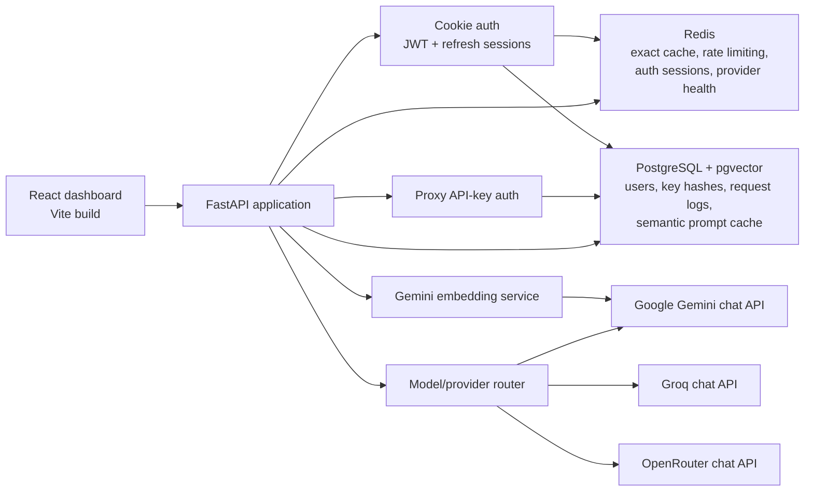
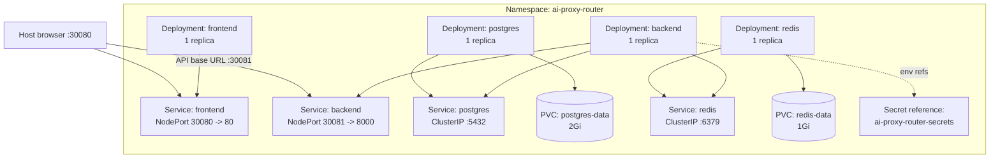

# Architecture

This document describes the implementation in this repository. It does not
assume a production ingress, autoscaling, or highly available deployment.

## System components



### Responsibilities

| Component | Responsibility |
| --- | --- |
| React/Vite frontend | Login/registration, protected dashboard, API-key management, chat Playground, provider health, and cache analytics. |
| FastAPI | Cookie-auth routes, API-key-authenticated chat/analytics/provider-health routes, CORS, response streaming, and request logging. |
| PostgreSQL | Users, API-key hashes and metadata, provider configuration, request/cost records, and semantic cache JSON/metadata. |
| pgvector | Similarity search over 768-dimensional prompt embeddings. |
| Redis | Exact-response cache, rate-limit state, refresh-token sessions and access-token blacklist, and provider-health/cooldown state. |
| Provider router | Resolves supported model names to Groq, Gemini, or OpenRouter and applies provider health/fallback logic. |
| Gemini embedding integration | Generates semantic-cache embeddings using the configured Gemini API credential. |

The API-key database model stores the SHA-256 key hash rather than the raw
secret. The frontend's currently connected key is tab-scoped and persisted in
`sessionStorage`; it is not synchronized to the backend.

## Chat request and cache flow

```mermaid
sequenceDiagram
    participant Client as React client
    participant API as FastAPI chat route
    participant Redis as Redis exact cache
    participant Embed as Embedding service
    participant PG as PostgreSQL + pgvector
    participant Provider as Provider router / LLM

    Client->>API: POST /v1/chat/completions (Bearer proxy key)
    API->>PG: Validate active key hash
    API->>Redis: Rate-limit and budget checks
    API->>API: Resolve requested model
    API->>Redis: Exact request lookup
    alt Redis exact hit
        Redis-->>API: Cached completion
        API-->>Client: JSON or SSE replay; X-Cache: HIT
    else Redis miss or lookup error
        API->>Embed: Embed prompt
        Embed-->>API: 768-dimensional vector or error
        API->>PG: Nearest semantic-cache lookup
        alt Valid candidate meets threshold
            PG-->>API: Cached completion
            API-->>Client: JSON or SSE replay; X-Cache: HIT
        else Semantic miss or lookup error
            API->>Provider: Request completion / stream
            Provider-->>API: Completion / SSE chunks
            API->>API: Assemble and validate completion
            opt Successful, cacheable completion
                API->>Redis: Save exact response (one-hour TTL)
                API->>PG: Save semantic entry when embedding is available
            end
            API-->>Client: JSON or streamed SSE; X-Cache: MISS
        end
    end
    API->>PG: Record one request row and applicable usage/cost
```

The semantic identity includes the resolved model and temperature; semantic
lookup uses the configured similarity threshold (default `0.90`). Lookup
errors are recorded separately and fall through. The current default semantic
TTL and Redis response-cache TTL are both one hour.

For streamed responses, the backend assembles provider SSE frames while
forwarding them to the client. It caches only complete streams with `[DONE]`,
no stream error, a finish reason for every choice, and no `finish_reason:
"length"`. Redis and semantic cache entries with that length finish reason are
rejected rather than replayed.

Request-log analytics are per API key and use `requests_log` rows. Redis and
semantic errors are distinct from misses. The cache hit rate is
`(redis_hits + semantic_hits) / total_requests * 100`. `provider_calls` counts
request rows where a provider was called at least once; provider retries or
fallback attempts do not increment that metric more than once for a request.

## Kubernetes resources

The manifests in `k8s/base/` define the following local topology:



`frontend` and `backend` are application Deployments and do not mount PVCs.
`postgres` mounts `postgres-data` at `/var/lib/postgresql`; `redis` mounts
`redis-data` at `/data` and starts Redis with append-only persistence enabled.
The claims are defined as `ReadWriteOnce` using the `hostpath` storage class,
with requested capacities of 2Gi and 1Gi, respectively.

The backend manifest references the `ai-proxy-router-secrets` Secret for
database/provider/JWT values. The Secret itself is not defined in
`k8s/base/`; it must be provisioned outside the checked-in manifests.

## Persistent and transient state

- **Persistent PVC-backed state:** PostgreSQL data and Redis append-only data.
- **PostgreSQL data without a volume claim of its own:** API-key hashes,
  account data, request logs, provider records, semantic cache entries.
- **Redis state:** exact cache entries, rate-limit buckets/windows, auth
  refresh/blacklist state, and provider health counters; persistence is
  configured by the Redis Deployment.
- **Ephemeral application workloads:** frontend and backend containers can be
  replaced during image updates; their Deployments do not themselves provide
  data persistence.
