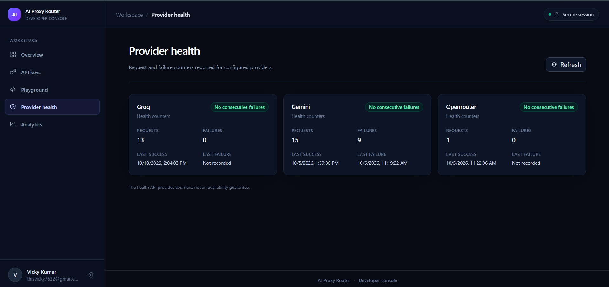
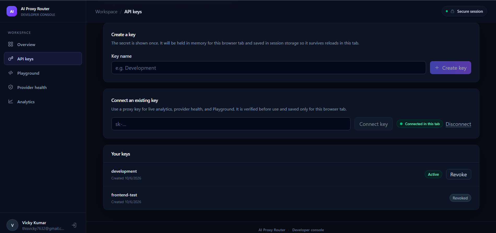
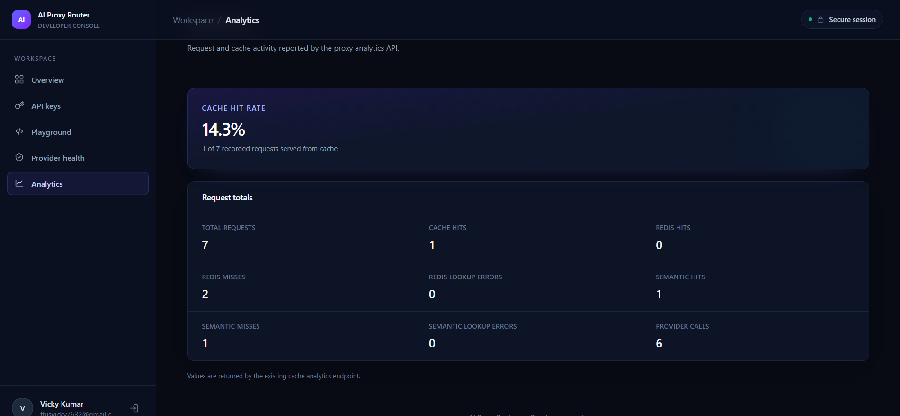
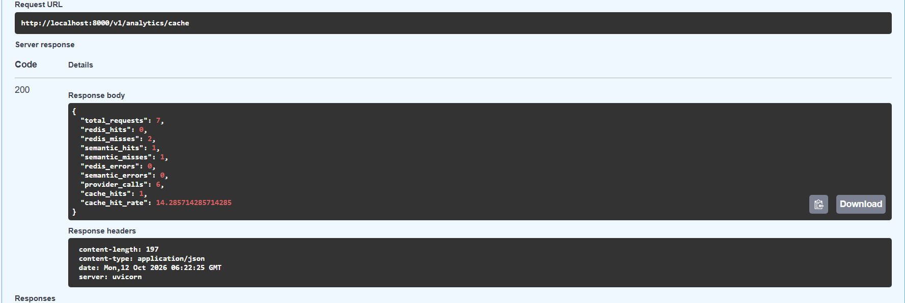

# Screenshots

These are screenshots present in this repository. Review them for account or
usage details before sharing them outside the project. In particular, the API
key management screenshot shows account information in the dashboard sidebar;
the visible key values are not shown.

## Dashboard and provider health

The dashboard's Provider health page displays request and failure counters
for Groq, Gemini, and OpenRouter.

## API key management

The API keys page shows key creation and connection controls plus active and
revoked key metadata. It does not display the raw key value.

## Cache analytics

The analytics page presents the cache hit rate and request totals, including
Redis, semantic-cache, and provider-call counts.

## Swagger analytics response

This Swagger UI capture shows a successful response from the cache analytics
endpoint. Its displayed request totals are the values in that screenshot and
should not be interpreted as current live metrics.

## Capturing additional screenshots

Use real captures from the running application; do not fabricate or edit
metric values. Hide proxy API keys, provider credentials, passwords, JWTs,
cookies, and personal or operational data. For Kubernetes captures, avoid
showing Secret contents or unrelated namespaces. Add any new images here
using their exact filenames and paths relative to this document.
